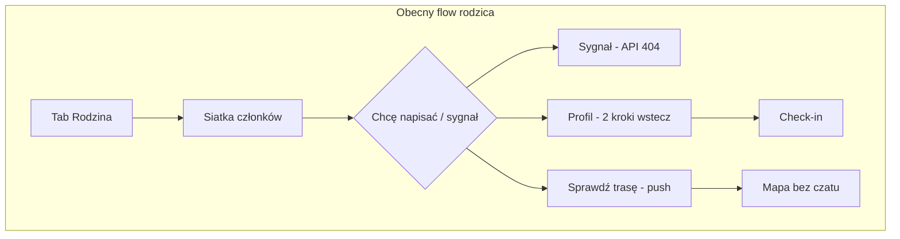
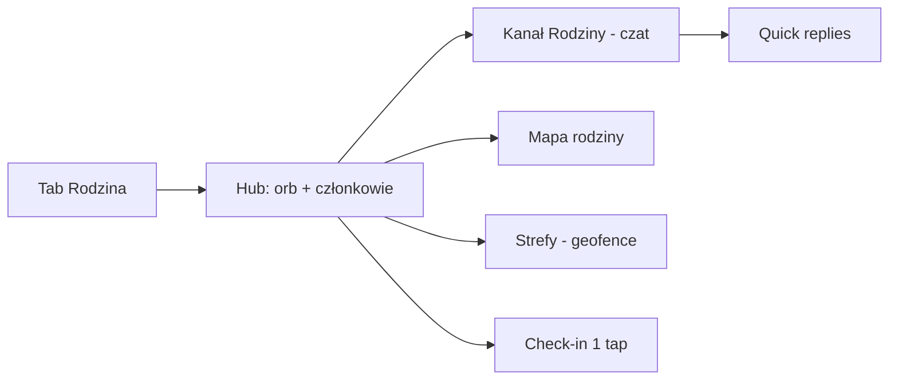

# Plan: czat rodzinny, uproszczenie UX i dostępność Rodziny

> **Data:** 2026-05-18  
> **Powiązane:** [ANALIZA_APLIKACJI.md](./ANALIZA_APLIKACJI.md), [design/stitch_v2/DESIGN.md](../design/stitch_v2/DESIGN.md), [design/stitch/v2_aqoir_inspired.md](../design/stitch/v2_aqoir_inspired.md)

---

## 1. Executive summary

**Czat grupy rodzinnej w praktyce nie istnieje.** Użytkownik ma rozproszone sygnały: check-in w Profilu, „Wyślij sygnał” na ekranie Rodziny (wywołuje **nieistniejący** endpoint API), komentarze tylko pod alertami społecznościowymi, eventy socket (`family:location`, `family:geofence_exit`, `family:checkin`) bez jednej osi czasu i bez UI czatu na web.

**Aplikacja jest zbyt skomplikowana** przez: 5–7 pozycji nawigacji (różne zestawy na Home / Mapa / web), duplikację ścieżek (Profil vs „Więcej” vs Ustawienia), głębokie zagnieżdżenie Rodziny (lista → mapa w osobnym push), brak widocznych etykiet w dolnej nawigacji.

**Kierunek:** jeden **wątek bezpieczeństwa rodziny** (czat + zdarzenia systemowe) + uproszczenie IA do **4 zakładek + SOS poza pillem**.

---

## 2. Stan obecny — komunikacja w rodzinie

### 2.1 Co jest zaimplementowane

| Mechanizm | Gdzie | Dostępność dla użytkownika |
|-----------|--------|----------------------------|
| **Check-in** „Jestem bezpieczny/a” | `POST /users/me/checkin` | Tylko **Profil** (`profile_screen.dart`) — 2+ kroki od Rodziny |
| **Wyślij sygnał** | `POST /family/groups/:id/ping` | Przycisk na `FamilyScreen` — **backend nie ma tej trasy** → błąd / snackbar |
| **Lokalizacja live** | Socket `family:location` | Mapa grupy (`FamilyGroupScreen`); rodzic musi wejść: Rodzina → „Sprawdź trasę” |
| **Geofence exit** | Socket `family:geofence_exit` | Powiadomienie w tle (`background_service.dart`), brak historii w UI |
| **Niski poziom baterii** | Socket `family:low_battery` | Backend emituje; mobile **nie subskrybuje** w `socket_service.dart` |
| **Check-in do rodzica** | Socket `family:checkin` | Backend emituje; mobile/web **nie pokazują** w UI Rodziny |
| **Komentarze** | REST + `alert:join` / `comment:new` | Tylko przy **alertach na mapie** — nie dotyczy rodziny |
| **Udostępnienie linku** | `POST /users/me/share-location` | Profil / ustawienia — osobny kanał |

### 2.2 Dlaczego „czat” jest prawie niedostępny



1. **Brak ekranu wiadomości** — karty członków (`_MemberCard`) nie są klikalne (brak `onTap`).
2. **Ping nie działa** — jedyny szybki przycisk komunikacji na Rodzinie jest martwy.
3. **Check-in schowany w Profilu** — mentalnie „konto”, nie „rodzina”.
4. **Web `/family`** — formularze grup/geofence, surowe `lat/lng`, brak mapy, brak socketów, brak czatu.
5. **Brak historii** — check-iny trafiają do `user_checkins`, ale rodzic nie ma listy „co się wydarzyło dziś”.

### 2.3 Porównanie z oczekiwaniami (Messenger / WhatsApp Family)

| Oczekiwanie użytkownika | be:Safe dziś | Luka |
|-------------------------|--------------|------|
| Jedna rozmowa grupy | Brak | **Krytyczna** |
| Szybkie „OK / jestem w drodze” | Brak quick replies | Wysoka |
| Historia „Anna: jestem bezpieczna” | Tylko push/socket, bez UI | Wysoka |
| Sygnał / ping | UI jest, API nie | **Bug P0** |
| Lokalizacja na żywo | Jest, ale głęboko w mapie | Średnia |
| Zdjęcia / głos | Brak | Niska (v2) |

**Rekomendacja produktowa:** nie budować pełnego Messengera — **jeden kanał „co się dzieje z rodziną”** (tekst + karty systemowe: check-in, geofence, ping, bateria).

---

## 3. Propozycja usprawnienia czatu rodzinnego

### 3.1 Wizja: „Kanał Rodziny”

Jeden wątek na `family_group_id` scalający:

- wiadomości tekstowe,
- quick replies („OK”, „Dzwonię”, „Jestem w drodze”, „Potrzebuję pomocy”),
- wpisy systemowe (check-in, ping, opuszczenie geofence, niska bateria),
- opcjonalnie krótki komentarz przy check-inie.

Komentarze pod **alertami społecznościowymi** pozostają osobno (mapa) — zgodnie z IA stitch_v2.

### 3.2 Model danych (MVP)

```sql
CREATE TYPE family_message_type AS ENUM (
  'text', 'quick_reply', 'checkin', 'ping', 'system'
);

CREATE TABLE family_messages (
  id UUID PRIMARY KEY DEFAULT uuid_generate_v4(),
  group_id UUID NOT NULL REFERENCES family_groups(id) ON DELETE CASCADE,
  sender_id UUID REFERENCES users(id),  -- NULL dla czysto systemowych
  type family_message_type NOT NULL,
  body TEXT,
  metadata JSONB,  -- template_id, lat, lng, geofence_name, battery_level
  client_msg_id VARCHAR(64),  -- idempotencja
  created_at TIMESTAMPTZ NOT NULL DEFAULT NOW(),
  UNIQUE (group_id, sender_id, client_msg_id)
);

CREATE INDEX idx_family_messages_group_time
  ON family_messages (group_id, created_at DESC);

-- Opcjonalnie MVP+1:
ALTER TABLE family_members
  ADD COLUMN last_read_message_id UUID REFERENCES family_messages(id);
```

### 3.3 API REST (MVP)

Wszystkie pod `memberOf` w `backend/src/routes/family.js`:

| Metoda | Ścieżka | Opis |
|--------|---------|------|
| `GET` | `/family/groups/:id/messages?before=&limit=50` | Historia (cursor po `created_at`) |
| `POST` | `/family/groups/:id/messages` | `{ type, body?, metadata?, client_msg_id? }` |
| `POST` | `/family/groups/:id/messages/read` | `{ last_read_message_id }` |
| `POST` | `/family/groups/:id/ping` | **Naprawa istniejącego mobile** → `type: ping` |

**Migracja check-in:** `POST /users/me/checkin` nadal zapisuje `user_checkins`, ale **dodatkowo** wstawia `family_messages` typu `checkin` dla każdej grupy dziecka (lub wybranej).

### 3.4 Socket.IO (MVP)

Wzorzec jak `alert:join` / `comment:new`:

| Kierunek | Event | Opis |
|----------|-------|------|
| Client → server | `family:join` / `family:leave` | Pokój `family:{groupId}` |
| Client → server | `family:typing` | Wskaźnik pisania |
| Server → room | `family:message` | Nowa wiadomość (tekst lub system) |
| Server → room | `family:read` | (v1.1) odczyt |

Przy `connection`: auto-join wszystkich grup użytkownika.

**Dual emit (ważne):** przy geofence / check-in / ping — zachować emit do `user:{parentId}` (mapa live) **oraz** persist + `family:message` w wątku grupy.

### 3.5 UI — mobile (MVP)

| Element | Propozycja |
|---------|------------|
| Wejście | Na `FamilyScreen`: **FAB „Wiadomości”** lub tap w kartę członka → `FamilyChatScreen` |
| Badge | Licznik nieprzeczytanych na tabie Rodzina |
| Lista | Odwrócona chronologia; karty systemowe (mint = safe, coral = alert) |
| Composer | Pole tekstu + chips quick replies |
| „Wyślij sygnał” | Zostaje; po naprawie API tworzy wpis `ping` w wątku |
| Check-in | Przenieść **nad composer** na Rodzinie (dziecko) lub sticky CTA „Jestem bezpieczny/a” |

Pliki: nowy `mobile/lib/screens/family/family_chat_screen.dart`; rozszerzenie `socket_service.dart`.

### 3.6 UI — web (MVP / v1.1)

- Panel czatu obok listy członków na `/family` (split desktop, drawer mobile).
- Rozszerzenie `SocketContext` o `family:message`, `onFamilyMessage`.
- v1.1: pełna parytet z mobile.

### 3.7 FCM

- Kanał `family_chat` (Android).
- Po `INSERT` wiadomości: push do członków grupy (bez nadawcy), jeśli nie są w pokoju socket.
- Tytuły kontekstowe: „Anna: Jestem bezpieczna”, nie „Nowa wiadomość”.

### 3.8 Fazy wdrożenia

| Faza | Zakres | Efekt dla użytkownika |
|------|--------|------------------------|
| **MVP** | Tabele + REST + socket + **naprawa `/ping`** + ekran czatu mobile + wpisy systemowe z check-in/geofence | Sygnał działa; jedna historia rodziny |
| **v1.1** | Read receipts, badge, web chat, check-in w wątku | Rodzic widzi web + nieprzeczytane |
| **v2** | Załączniki, własne quick replies, mute, retencja 90 dni | Zbliżenie do messengera bez nadmiaru |

---

## 4. Analiza UI/UX — dlaczego aplikacja jest „za trudna”

### 4.1 Nawigacja mobile

**Problem:** brak wspólnego **shella** (IndexedStack). Każdy tab robi `Navigator.push` — na Rodzinie/Profilu znika dolny pasek.

| Ekran | Pozycje w `PillNavBar` |
|-------|-------------------------|
| Home | 6: Mapa, **Home**, Rodzina, Profil, SOS, **Więcej** |
| Mapa | 5: Mapa, Home, Rodzina, Profil, SOS |
| `defaultItems` (nieużywane) | 5: Mapa, **Alerty**, Rodzina, Profil, SOS |

Tablet (`map_screen`): `NavigationRail` z osobną destynacją **Alerty** — czwarta wersja IA.

**Skutek:** użytkownik nie wie, gdzie jest; SOS ma dwa różne flow (ekran hold vs dialog na mapie).

### 4.2 Nawigacja web

`Sidebar.tsx`: **7** pozycji równorzędnych. Mobile bottom bar: tylko **pierwsze 5** — Profil i Ustawienia ukryte za hamburgerem przy pełnym menu 7-pozycyjnym.

### 4.3 Rozproszenie funkcji (duplikaty)

| Funkcja | Wejścia dziś |
|---------|----------------|
| Moje alerty | Tab/map, dzwonek Home, karta „potwierdzenia”, menu Więcej |
| Ustawienia | Tab Więcej, Profil, osobny `/settings` web |
| Ranking / odznaki / news | Menu Więcej **i** Profil |
| Check-in | Tylko Profil |
| Rodzina / mapa | Rodzina → osobny push `FamilyGroupScreen` |

### 4.4 Rodzina vs design stitch_v2

Design (`rodzina_be_safe`, `lokalizacja_rodziny`) zakłada spokojny hub z orbem i kartami członków — **kod to częściowo realizuje**, ale:

- brak czatu / osi zdarzeń,
- „Sprawdź trasę” brzmi jak funkcja power-usera zamiast „Zobacz na mapie”,
- brak tap na kartę członka (mapa + wiadomość).

### 4.5 Web Rodzina

- Geofence tworzone ze **stałych współrzędnych Warszawy** (`52.2297, 21.0122`) — dezorientacja.
- Lista członków pokazuje surowe `lat, lng` zamiast „Ostatnio: 5 min temu · Bezpieczny”.
- `SocketContext` ma `family:location`, ale **`family/page.tsx` ich nie używa**.

---

## 5. Proponowana Information Architecture (uproszczona)

### 5.1 Persony i cele

| Persona | Priorytet | Start aplikacji |
|---------|-----------|-----------------|
| **Rodzic** | Status dzieci, geofence, szybki kontakt | **Rodzina** lub **Dom** (skrót „2/2 online”) |
| **Nastolatek** | Prywatność, check-in, mapa okolicy | **Dom** / **Mapa** |
| **Użytkownik mapy** | Zagrożenia w promieniu, zgłoszenia | **Mapa** |

**4 cele produktu:** (1) bezpieczna okolica, (2) reakcja na zagrożenia, (3) bliscy OK, (4) SOS / zgłoszenie.

### 5.2 Menu główne — 4 pozycje + SOS

Zgodnie z `v2_aqoir_inspired.md` i stitch_v2:

```
┌──────────────────────────────────────┐
│  [Avatar]              [🔔] [SOS]    │  ← SOS: FAB / hold, NIE 5. tab
├──────────────────────────────────────┤
│         Treść (IndexedStack)          │
├──────────────────────────────────────┤
│  [ Dom ]  [ Mapa ]  [ Rodzina ]  [ Konto ] │
└──────────────────────────────────────┘
```

| Tab | Zawartość |
|-----|-----------|
| **Dom** | Glow orb, status okolicy, 3 karty skrótów, CTA „Zgłoś” |
| **Mapa** | Mapa + piny + bottom sheet alertów + filtry + **komentarze przy alercie** |
| **Rodzina** | Orb statusu grupy, karty członków (tap → czat / mapa), **Kanał Rodziny**, check-in, geofence |
| **Konto** | Profil, powiadomienia, prywatność, **Społeczność** (ranking, odznaki, statystyki) |

**„Więcej” (mobile) / dolna sekcja sidebar (web):** Aktualności, numery alarmowe, regulamin, referral — rzadkie.

### 5.3 Decyzje scalania

| Pytanie | Decyzja |
|---------|---------|
| Mapa + Alerty? | **Tak** — jeden moduł |
| Rodzina + czat alertów społeczności? | **Nie** — czat rodzinny osobno |
| Dom + Mapa? | **Oba** — Dom = spokój, Mapa = operacje |
| Statystyki + Ranking? | **Konto → Społeczność** |

### 5.4 Uproszczony flow Rodziny (docelowy)



**Redukcja kroków:**

| Akcja | Dziś | Docelowo |
|-------|------|----------|
| Wyślij sygnał | 1 tap → błąd API | 1 tap → wpis w kanale + push |
| Check-in | Profil (2+ kroki) | 1 tap na Rodzinie |
| Napisz do rodziny | Brak | 1 tap na kartę / FAB czat |
| Zobacz mapę dziecka | Rodzina → Sprawdź trasę | Tap karty → mapa **lub** segment w Rodzinie |

---

## 6. Rekomendacje UI/UX z priorytetami

### P0 — krytyczne

| # | Obszar | Działanie |
|---|--------|-----------|
| 1 | **API** | Zaimplementować `POST /family/groups/:id/ping` + fundament `family_messages` |
| 2 | **Nawigacja** | Shell 4 tabów (`IndexedStack`) + jeden zestaw `PillNavBar` |
| 3 | **SOS** | Jeden flow (`SosScreen` / hold); usunąć duplikat na mapie |
| 4 | **Rodzina web** | Mapa członków + socket live; geofence z mapy (nie hardcoded PL) |
| 5 | **Dostępność** | Widoczne etykiety pod ikonami nav; touch target ≥ 44dp |

### P1 — wysokie

| # | Obszar | Działanie |
|---|--------|-----------|
| 6 | **Czat MVP** | `FamilyChatScreen` + quick replies + wpisy systemowe |
| 7 | **Check-in** | CTA na Rodzinie; wpisy w kanale |
| 8 | **Profil / Więcej** | Scalić menu konta; usunąć duplikaty ranking/odznaki |
| 9 | **Web nav** | Sidebar 4 pozycje; bottom bar = te same 4 |
| 10 | **Karty członków** | `onTap` → czat lub mapa; status zamiast współrzędnych na web |

### P2 — dopracowanie

| # | Obszar | Działanie |
|---|--------|-----------|
| 11 | **Onboarding** | 2–3 slajdy + prośba o GPS/FCM z uzasadnieniem |
| 12 | **Ustawienia** | Spójny Serenity (jak Profil/Rodzina) |
| 13 | **Warstwa rodziny na mapie głównej** | Toggle „Pokaż bliskich” |
| 14 | **Read receipts, mute, media** | Faza v2 czatu |

---

## 7. Propozycje ekranów (wireframe opisowy)

### 7.1 Rodzina — hub (po redesignie)

```
┌─────────────────────────────────┐
│ ←  Twoja Rodzina        [QR] [⋮] │
│         (Glow Orb 2/3)          │
│      Wszyscy bezpieczni          │
├─────────────────────────────────┤
│ [Kanał Rodziny ────────── (3)] │  ← badge nieprzeczytane
│  · Mama: Jestem w szkole  10:02 │
│  · System: Ania opuściła… 09:41 │
├─────────────────────────────────┤
│ [Ania]  [Tata]  [Ja]            │  ← tap → czat 1:1 w grupie / mapa
├─────────────────────────────────┤
│ [ Jestem bezpieczny/a ]          │  ← dziecko
│ [ Wyślij sygnał ]  [ Mapa ]      │
└─────────────────────────────────┘
```

### 7.2 Kanał Rodziny (czat)

```
┌─────────────────────────────────┐
│ ←  Rodzina Kowalscy              │
├─────────────────────────────────┤
│        ... wiadomości ...        │
│ [System] Geofence: szkoła OK     │
│ [Ania] Dobra, wracam 14:20       │
├─────────────────────────────────┤
│ [OK] [Dzwonię] [W drodze] [Help]│
│ [_______________] [Wyślij]       │
└─────────────────────────────────┘
```

---

## 8. Harmonogram sugerowany

| Sprint | Backend | Mobile | Web |
|--------|---------|--------|-----|
| **S1** | `ping`, `family_messages`, socket `family:message` | Naprawa sygnału; podstawowy czat | Socket + lista wiadomości |
| **S2** | Check-in → wpis w wątku; FCM | Shell 4 tabów; check-in na Rodzinie | Mapa rodziny, geofence na mapie |
| **S3** | Read receipts | Badge, quick replies | Sidebar 4 pozycje; statusy członków |
| **S4** | v2 (mute, media) | Warstwa rodziny na mapie | Społeczność w Konto |

---

## 9. Metryki sukcesu

| Metryka | Opis |
|---------|------|
| **Time-to-family-message** | Czas od otwarcia app do wysłania wiadomości / ping < 10 s |
| **Ping success rate** | > 99% (dziś ~0% przy braku endpointu) |
| **Check-in z Rodziny** | % check-inów z ekranu Rodzina vs Profil |
| **Task success (testy)** | Rodzic: „Wyślij sygnał do dziecka” — bez pomocy |
| **NPS / ankieta** | „Łatwość kontaktu z rodziną” przed/po |

---

## 10. Podsumowanie

1. **Czat rodzinny** to luka produktowa, nie tylko UX — trzeba dodać model, API, socket i UI; naprawić **ping** jako szybki pierwszy krok.
2. **Dostępność Rodziny** rośnie przez: kanał na głównym ekranie Rodziny, check-in w 1 tap, klikalne karty, działający sygnał, web z mapą i live socket.
3. **Uproszczenie całej app** przez **4 taby + SOS**, scalenie Mapa+Alerty i Konto+Ustawienia+gamifikacja, jeden shell nawigacji — zgodnie z design system Serenity Guard.

Kolejny krok implementacyjny (rekomendowany): **S1 — backend `family_messages` + `POST .../ping` + minimalny `FamilyChatScreen`**.
