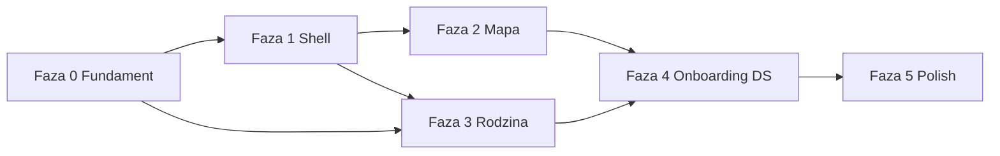

# Plan globalny UI/UX i wdrożenie — be:Safe

> **Data:** 2026-05-18  
> **Metoda:** analiza kodu (mobile, web, design stitch_v2) + 10 perspektyw specjalistycznych  
> **Powiązane:** [PLAN_RODZINA_CZAT_I_UX.md](./PLAN_RODZINA_CZAT_I_UX.md), [ANALIZA_APLIKACJI.md](./ANALIZA_APLIKACJI.md), [design/stitch_v2/DESIGN.md](../design/stitch_v2/DESIGN.md)  
> **Wizualizacja:** otwórz w Cursorze plik Canvas `canvases/ux-before-after.canvas.tsx` (porównanie 1:1 obecny vs docelowy)

---

## 1. Executive summary

Aplikacja **be:Safe** ma silny fundament wizualny (**Serenity Guard** na mobile) i spójny backend, ale **doświadczenie użytkownika jest rozbite** przez:

- **3–4 równoległe modele nawigacji** (6-tab Home, 5-tab Mapa, 7-pozycyjny web, stitch 5-icon),
- **brak wspólnego shella** (`Navigator.push` zamiast tabów),
- **duplikację ścieżek** (Profil / Więcej / Ustawienia / dzwonek / karty),
- **luki produktowe** (czat rodzinny, ping API 404, web Rodzina bez mapy),
- **rozjazd marki** (mobile spokojny vs web/landing „panic red”).

**Kierunek globalny:** jedna **Information Architecture** na mobile i web:

```
Dom · Mapa · Rodzina · Konto   +   SOS (poza tabami)
```

Wdrożenie w **5 fazach** (ok. 14–20 tygodni przy 1 zespole), z metrykami sukcesu i checklistą parity.

---

## 2. Metodologia — 10 perspektyw analizy

| # | Perspektywa | Główne ustalenia |
|---|-------------|------------------|
| 1 | **Nawigacja mobile** | Brak `IndexedStack`; 6/5/5 ikon; SOS w pillu; fallback route → Mapa |
| 2 | **Nawigacja web** | 7 pozycji sidebar, 5 w bottom bar; brak ekranu Dom; `/` duplikuje layout |
| 3 | **Onboarding & auth** | 5 slajdów + osobny login; brak permission priming; mobile forgot-password → błędny route |
| 4 | **Mapa & alerty** | Lista na mapie nie otwiera detail (mobile); web click-to-create; brak jednego bottom sheet |
| 5 | **Home / status** | Dom wartościowy (stitch `ekran_glowny`); nie scalać z Mapą; `mapa_status` = chip na mapie |
| 6 | **Rodzina & SOS** | Ping 404; check-in w Profilu; 3 flow SOS; Rodzina gubi nav |
| 7 | **Profil & gamifikacja** | Ranking/stats/news w menu Więcej **i** Profilu; web stats/ranking w top nav |
| 8 | **Design system** | 12 ekranów Serenity, 8 partial (mapa, ustawienia, grupa rodzinna) |
| 9 | **A11y & copy** | i18n tylko w settings; Semantics punktowo; nav bez widocznych labeli |
| 10 | **Landing & parity** | Landing over-promises; brak Play/App Store; web ≠ mobile w rodzinie/push |

---

## 3. Obecna vs docelowa architektura informacji

### 3.1 Mobile — dziś

```
[AuthGate]
    → Onboarding (5) → Login
    → HomeScreen (root)
         PillNav: Mapa | Home | Rodzina | Profil | SOS | Więcej
         push → Map / Family / Profile / SOS / menu (7+ routes)
```

**Problemy:** 6 pozycji, ang. „Home”, SOS w pillu, Więcej = schowana połowa funkcji.

### 3.2 Web — dziś

```
/landing (marketing czerwony)
/ → MapView (+ własny Sidebar, nie AppLayout)
Sidebar: Mapa | Moje alerty | Rodzina | Stats | Ranking | Profil | Ustawienia
Mobile bottom: pierwsze 5 tylko
```

### 3.3 Docelowo (mobile + web)

```
┌─────────────────────────────────────────────┐
│ AppBar: [Avatar→Konto]  tytuł    [🔔] [SOS] │
├─────────────────────────────────────────────┤
│              IndexedStack / route            │
│   Dom | Mapa | Rodzina | Konto              │
├─────────────────────────────────────────────┤
│  Dom    Mapa    Rodzina    Konto            │  ← widoczne etykiety
└─────────────────────────────────────────────┘
     SOS = FAB coral (hold) — NIE w pillu
```

| Tab | Mobile | Web (route) | Zawartość |
|-----|--------|-------------|-----------|
| **Dom** | `HomeScreen` (shell) | `/` lub `/home` | Orb, poziom bezpieczeństwa, 3 skróty |
| **Mapa** | `MapScreen` | `/map` | Mapa + **draggable sheet**: W okolicy / Moje / Detail / Statystyki skrót |
| **Rodzina** | `FamilyScreen` + chat | `/family` | Hub + **Kanał Rodziny** + mapa + check-in |
| **Konto** | `ProfileScreen` hub | `/account` | Profil, ustawienia, społeczność, prawne |

**Sekundarne** (push / drawer, nie top-nav): create alert (sheet), alert detail, family map, legal, onboarding.

---

## 4. Globalne zmiany UI/UX (katalog)

### 4.1 Nawigacja i shell (P0)

| Zmiana | Uzasadnienie |
|--------|--------------|
| `MainShell` + `IndexedStack` (mobile) | Tab nie gubi dolnego paska |
| Jeden `navItems` (web) — 4 pozycje, ten sam bottom bar | Koniec rozjazdu 7 vs 5 |
| Usunąć tab **Więcej** | Funkcje → Konto |
| SOS **poza** pill/tab | Zgodnie z v2_aqoir; mniej pomyłek |
| Widoczne **etykiety** pod ikonami | Discoverability + a11y |
| Ujednolicić **tablet NavigationRail** z 4 tabami | Parity |

### 4.2 Mapa + alerty (P0–P1)

| Zmiana | Uzasadnienie |
|--------|--------------|
| **Jeden draggable bottom sheet** (peek / half / full) | Scalenie mapy i listy (stitch) |
| Tap lista/marker → detail w sheet | Naprawa bugów mobile/web |
| Web: tworzenie alertu **tylko z FAB**, nie click map | Mniej przypadkowych zgłoszeń |
| Rozdzielić copy: **„W okolicy”** vs **„Moje zgłoszenia”** | Koniec mylenia z dzwonkiem |
| Statystyki: wejście z sheet lub Dom, nie tylko Więcej | -2 kroki |

### 4.3 Rodzina + komunikacja (P0–P1)

| Zmiana | Uzasadnienie |
|--------|--------------|
| **Kanał Rodziny** (czat + zdarzenia systemowe) | Jedna oś czasu; patrz PLAN_RODZINA_CZAT |
| Naprawa `POST .../ping` | Obecny przycisk martwy |
| **Check-in** na Rodzinie (nie Profil) | 1 tap |
| Karty członków **klikalne** → czat / mapa | discoverability |
| Web: mapa + socket + geofence z mapy | Parity z mobile |
| „Sprawdź trasę” → **„Zobacz na mapie”** | Prostszy język |

### 4.4 Konto i gamifikacja (P1)

| Zmiana | Uzasadnienie |
|--------|--------------|
| Hub **Konto** = profil + ustawienia + **Społeczność** | Jeden mental model |
| Web: wycofać `/stats`, `/ranking` z top-nav | Mniej szumu |
| Mobile: usunąć duplikaty z menu Więcej | Jedna lista w Koncie |

### 4.5 Onboarding & auth (P1)

| Zmiana | Uzasadnienie |
|--------|--------------|
| **3 ekrany** + permissions (lokalizacja, push) | Time-to-value |
| Auth na ostatnim slajdzie (jak stitch finał) | -1 krok |
| Mobile: route `/forgot-password` → webview lub ekran | Bug P0 |
| Web login: link „Zapomniane hasło” | Parity |
| Auth pages w **Serenity** (nie czerwony legacy) | Spójność marki |

### 4.6 Design system (P1–P2)

| Zmiana | Uzasadnienie |
|--------|--------------|
| Tokeny statusów mapy/rodziny zamiast `Colors.green/red` | 8 ekranów partial → Serenity |
| `settings_screen`, `family_group_screen` na `SerenityCard` | Spójność |
| Landing + web: migracja do **Serenity palette** | Jedna marka |
| Opcja: wymusić motyw `serenity` lub usunąć 6 seedów | Mniej rozjazdu Theme.of |

### 4.7 A11y & copy (P1–P2)

| Zmiana | Uzasadnienie |
|--------|--------------|
| Globalne `locale` + `S.get` na mobile | EN nie iluzoryczne |
| `Semantics` na wszystkich CTA | TalkBack |
| Web: `aria-label`, min-h 44px | WCAG |
| **Copy guidelines** (spokojny ton) — sekcja 8 | Spójność PL/EN |

### 4.8 Landing & marketing (P2)

| Zmiana | Uzasadnienie |
|--------|--------------|
| Landing Serenity (navy/mint, nie red-500) | Zgodność z app |
| CTA: APK + Web + „funkcje tylko w app” | Uczciwość |
| Stopka: regulamin, prywatność | Compliance |
| Tabela Web vs App | Mniej over-promise |

---

## 5. Macierz ekranów — stan migracji

| Ekran / obszar | Mobile dziś | Web dziś | Docelowo |
|----------------|-------------|----------|----------|
| Shell nawigacji | Push stack | 7-item sidebar | 4-tab shell |
| Dom / status | Home ✓ | Brak | `/` lub `/home` |
| Mapa | Partial Serenity | Map ✓ | + bottom sheet |
| Rodzina | Hub partial | CRUD only | Hub + chat + map |
| Konto | Profil + Więcej | profile + settings | `/account` |
| SOS | 3 flows | Dialog | 1 hold flow |
| Onboarding | 5 slajdów | Brak | 3 + permissions |
| Landing | — | Red marketing | Serenity |

---

## 6. Plan wdrożenia (fazy)

### Faza 0 — Fundament (tydz. 1–2) — P0

**Cel:** naprawić blokery zaufania i martwe UI.

| ID | Zadanie | Mobile | Web | Backend |
|----|---------|--------|-----|---------|
| 0.1 | `POST /family/groups/:id/ping` + `family_messages` MVP | — | — | ✓ |
| 0.2 | Naprawa listy alertów → detail (mobile) | ✓ | — | — |
| 0.3 | InfoWindow „Szczegóły” (web) | — | ✓ | — |
| 0.4 | Wyłączyć click-map-create (web) | — | ✓ | — |
| 0.5 | Route mobile forgot-password | ✓ | — | — |
| 0.6 | `AppLayout` na `/` (web) | — | ✓ | — |

**Kryterium wyjścia:** ping działa; tap na alert otwiera detail; brak przypadkowego create na web.

---

### Faza 1 — Shell nawigacji (tydz. 3–5) — P0

**Cel:** 4 taby + SOS poza pillem.

| ID | Zadanie | Mobile | Web |
|----|---------|--------|-----|
| 1.1 | `MainShell` + `IndexedStack` | ✓ | — |
| 1.2 | `PillNavBar` 4 pozycje + labele | ✓ | — |
| 1.3 | Globalny SOS FAB → `SosScreen` | ✓ | ✓ |
| 1.4 | Usunąć SOS z pill / map dialog | ✓ | ✓ |
| 1.5 | Sidebar 4 pozycji + bottom bar = 4 | — | ✓ |
| 1.6 | Hub `/account` (scalenie profile+settings) | — | ✓ |

**Kryterium:** użytkownik nie traci nav na Rodzinie/Profilu; web mobile bar = sidebar.

---

### Faza 2 — Mapa + alerty (tydz. 6–8) — P1

| ID | Zadanie | Mobile | Web |
|----|---------|--------|-----|
| 2.1 | Draggable bottom sheet (peek/half/full) | ✓ | ✓ panel |
| 2.2 | Segmenty: W okolicy / Moje / Detail | ✓ | ✓ |
| 2.3 | Wycofać `/alerts` z top-nav | — | ✓ |
| 2.4 | Create alert jako half-sheet | ✓ | ✓ (już modal) |
| 2.5 | Po głosie nie zamykać detail | ✓ | ✓ |

---

### Faza 3 — Rodzina + kanał (tydz. 9–12) — P0/P1

| ID | Zadanie | Mobile | Web |
|----|---------|--------|-----|
| 3.1 | `FamilyChatScreen` + socket | ✓ | ✓ |
| 3.2 | Sekcja Kanał na hubie Rodziny | ✓ | ✓ |
| 3.3 | Check-in na Rodzinie | ✓ | ✓ |
| 3.4 | Mapa rodziny (socket live) | ✓ | ✓ |
| 3.5 | Geofence z mapy (web) | — | ✓ |
| 3.6 | FCM family_chat | ✓ | opcjonalnie |

**Kryterium:** komunikacja rodzinna w &lt;10 s od otwarcia tabu Rodzina.

---

### Faza 4 — Onboarding, DS, a11y (tydz. 13–16) — P1/P2

| ID | Zadanie |
|----|---------|
| 4.1 | Onboarding 3 ekrany + permissions |
| 4.2 | Serenity na `settings`, `family_group`, map markers |
| 4.3 | i18n globalne mobile + aria web |
| 4.4 | Konto → sekcja Społeczność (stats, ranking, badges) |
| 4.5 | Landing Serenity + Web vs App |

---

### Faza 5 — Polish & parity (tydz. 17–20) — P2

| ID | Zadanie |
|----|---------|
| 5.1 | Warstwa rodziny na mapie głównej (toggle) |
| 5.2 | Read receipts, mute czatu |
| 5.3 | Tablet rail = 4 taby |
| 5.4 | Audyt kontrastu WCAG |
| 5.5 | Dokumentacja design ↔ kod (stitch README) |

---

## 7. Zależności między fazami



**Równolegle możliwe:** F0 backend + F1 mobile shell; F2 web mapa po F1 web nav.

---

## 8. Wytyczne copy (globalne)

| Zasada | Przykład |
|--------|----------|
| Spokój, bez alarmizmu | „Coś niepokojącego w okolicy” |
| Czynność na początku | „Zgłoś zagrożenie”, „Jestem bezpieczny/a” |
| Jedna nazwa = jedna funkcja | Zawsze „Alerty” w nav (nie „Moje zgłoszenia” w tabie) |
| SOS: intencja + skutek | „Wyślesz alert z lokalizacją. Powiadomimy rodzinę.” |
| Rodzina: ludzkie | „Anna jest w bezpiecznej strefie” |
| Błędy: co dalej | „Nie udało się wysłać. Sprawdź połączenie.” |

**Etykiety tabów (PL):** Dom · Mapa · Rodzina · Konto

---

## 9. Metryki sukcesu

| Metryka | Baseline (szac.) | Cel po F3 |
|---------|------------------|-----------|
| Time-to-first-family-contact | Brak czatu; ping fail | &lt; 10 s |
| Kroki do check-in (dziecko) | 2+ (Profil) | 1 (Rodzina) |
| Task success: „wyślij sygnał” | ~0% (API) | &gt; 95% |
| Kroki: zgłoszenie alertu z Dom | 1 FAB | 1 (bez zmiany) |
| SUS / ankieta „łatwość” | — | +15 pkt po F1+F2 |
| Bounce z landingu na web | — | śledzić; CTA clarity |

---

## 10. Zasoby i pliki kluczowe

### Nowe (proponowane)

| Plik | Opis |
|------|------|
| `mobile/lib/screens/shell/main_shell.dart` | IndexedStack + nav |
| `mobile/lib/screens/family/family_chat_screen.dart` | Kanał rodziny |
| `web/src/app/account/page.tsx` | Hub Konto |
| `web/src/components/family/FamilyChatPanel.tsx` | Czat web |
| `web/src/components/map/AlertsBottomSheet.tsx` | Sheet mapy |
| `db/migrations/xxx_family_messages.sql` | Schema czatu |

### Modyfikacje istotne

| Plik |
|------|
| `mobile/lib/main.dart` |
| `mobile/lib/widgets/pill_nav_bar.dart` |
| `mobile/lib/screens/home/home_screen.dart` |
| `mobile/lib/screens/map/map_screen.dart` |
| `mobile/lib/screens/family/family_screen.dart` |
| `web/src/components/ui/Sidebar.tsx` |
| `web/src/app/page.tsx` |
| `web/src/app/family/page.tsx` |
| `backend/src/routes/family.js` |
| `web/src/app/landing/page.tsx` |

### Design reference (1:1)

| Docelowy UI | Stitch HTML |
|-------------|-------------|
| Dom | `ekran_glowny_status_okolicy` |
| Mapa + sheet | `mapa_widok_szczegolowy`, `alerty_bezpieczenstwa` |
| Rodzina | `rodzina_be_safe`, `lokalizacja_rodziny` |
| Konto | `profil_u_ytkownika` |
| SOS | `sos_be_safe` |
| Onboarding | `onboarding_*` (skrócone do 3) |

---

## 11. Ryzyka wdrożenia

| Ryzyko | Mitygacja |
|--------|-----------|
| Duży refactor nav — regresje | Feature flag `use_new_shell`; beta track |
| Użytkownicy przyzwyczajeni do 6 tabów | Komunikat in-app + onboarding 1 slajd |
| Web użytkownicy bez Dom | Opcja „start na mapie” w ustawieniach |
| Czat = scope creep | MVP tylko tekst + system events; media v2 |
| Breaking deep links | Mapowanie starych URL na nowe taby |

---

## 12. Podsumowanie decyzyjne

| Pytanie | Decyzja |
|---------|---------|
| Ile tabów? | **4** (+ SOS globalny) |
| Czy usunąć Dom? | **Nie** — zostaje tab spokoju |
| Mapa + Alerty? | **Tak** — jeden moduł ze sheet |
| Czat rodzinny? | **Tak** — Kanał Rodziny (MVP w F3) |
| Priorytet #1? | **F0 + F1** (ping, shell, SOS) |
| Marka? | **Serenity everywhere** (F4+) |

---

*Dokument uzupełnia [PLAN_RODZINA_CZAT_I_UX.md](./PLAN_RODZINA_CZAT_I_UX.md) o **globalny** program UX, nie tylko moduł rodziny. Wizualizacje before/after: Canvas w repozytorium projektu Cursor (`canvases/ux-before-after.canvas.tsx`).*
